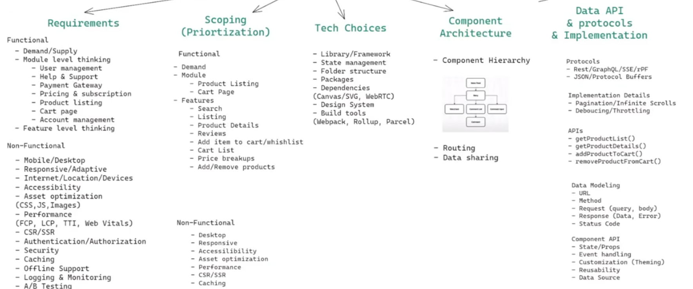
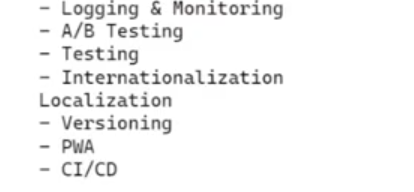
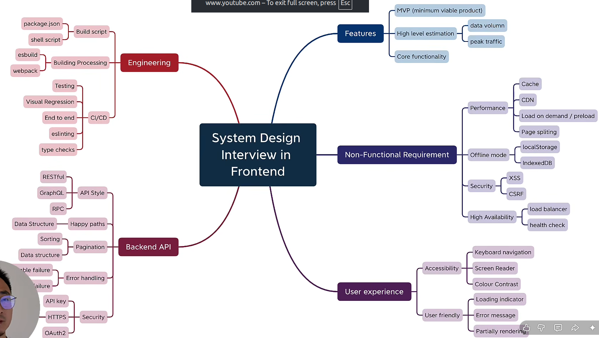

# Basics

- never rush to implement
- always talk to interviewer about the requirement and if u are understanding in the right direction
- practice 2-3 system design question by yourself on some online platform which make it comfortable to use (draw.io)

# Frontend System Design

- HLD and LLD, 2 type of system design




HLD have Requirement gathering, Scoping and Tech choices where as in LLD we discuss about Component Architecture and Data API and protocols and implementations.

## FSD components

### Architectural Pattern

- Monolithic frontend - when all project component reside in one tree
- Micro frontend - when for each specific task like dine-in area, swimming pool area etc. are treated as 1 specific component and the main benefit is we can design them with different technology and integrate them.
  - Different ways fir integrations are - Iframe, web components, module federation, micro apps/ route based.

### Communication Protocol

- Long pooling - keep sending request to server and server reply for each request.
- websocket - 2 way commmunication but no need to send request always.
- server sent event - 1 way communication, once client sent the request now server will only reply - like email subscribe, msg notification etc.

### Availability

- When if we are offline we want to keep user enggaged then this helps. Mainly Service worker helps to achieve this.

A `Service Worker` is a JavaScript script that runs in the background, separately from the web page, and acts as a proxy between the browser and the network.

**A Service Worker is a background JavaScript worker that intercepts network requests and enables caching, offline functionality, push notifications, and background synchronization.**

Key responsibilities:

1. Caching: Caches resources for faster loading.
2. Offline support: Allows applications to work without an internet connection.
3. Push notifications: Receives notifications even when the website isn't open.
4. Background sync: Syncs data when the internet connection is restored.

`It has no direct access to the DOM and communicates with the page through messages.`

`Workbox` gives us a service workeer setup which we can use for various purpose like precaching, runtime caching, request routing, strategies, background sync and debugging etc.

### Accessibility

- Keyboard accessibility
- screen reader
- color/contrast

### Consistency

- CSS properties
- Polyfills in JS
- now we use Design system like AntUI, fluent ui, material ui etc which itself manages different browwser version adaptability.

### Credibility and Trust(SEO)

- On-page
  - Title
  - description
  - meta
  - performance
  - content
- Off-page
  - Backlinks 
  - ads

### Logging and Monitoring

- Error Logging
- User tracking
- User activity
- Feature usage
- Infra/ Capacity monitoring

### Database/ Caching

- HTTP caching
- in-memory caching
- apollo caching
- state management(redux, context, zustand)
- local storage
- session storage
- cookies
- IndexedDB

### Security

- Authetication/ Authorization
- CSP - Content security policy
- CORS
- Man in the middle

### Performance and Optimization

- Assets Optimization
- Delivery Option
- Build assets
- SSR (server side rendering)
- service worker
- web vitals
- Percieved performance (visible to user)

### Testing

- unit testing - jest,mocha,chai
- integration testing - cypress
- end to end testing (E2E) - Playwright

## Network Optimization

1. `Load JS asynchronously`

- we can load `<script>` directly which will halt our program for script download and script execution but when we `<script async>` for loading script file then it do the script downlad async way in the case of html parsing but again halt the html parsing for script execution but if we write `<script defer>` it will help to execute the script once the html page rendered completely so that our initial rendering will not be a blank screen.

2. `Lazy loading`

- `Lazy attribute` -> img or iframe can be make `loading="lazy" or "eager"` depending on its requirement on hero section or in the below page. also in the eager section we can set the `fetchpriority` as low or high.

- `Intersection Observer` -> it is a JavaScript Web API that detects when an HTML element enters or leaves the browser's viewport (visible area).
Common use cases:
  1. Lazy loading images.
  2. Infinite scrolling.
  3. Triggering animations when elements become visible.
  4. Tracking how much of an element is visible.

- `Content Visibility` -> It is a CSS property that allows the browser to skip rendering off-screen content until it becomes visible. It improves performance, especially on long pages with many elements.

- `Serving critical css` -> loading the CSS required to render the `above-the-fold` content (the part visible immediately without scrolling) before loading the remaining CSS.

This helps improve `First Contentful Paint` (FCP) and `Largest Contentful Paint` (LCP).

Critical CSS reduces render-blocking CSS and helps the browser display meaningful content faster.

3. `Resource hinting` - It means giving the browser hints about which resources or connections it should prepare in advance to improve page-loading performance.

- `Preload` : Loads an important resource early.ex: Critical fonts, images, CSS.
- `Prefetch` : Downloads resources likely needed in the future.ex: Resources for the next page.
- `preconnect` : Establishes an early connection to another domain.ex: API or CDN connections.
- `dns-prefetch` : Resolves the domain's DNS early. ex: External domains.
- `prerender` : Loads and renders a likely next page in advance. ex: When the user is very likely to navigate to that page.
- `moduleprelad` : Downloads and prepares a JavaScript ES module early. ex: Important JS modules and dependencies.

### Rendering Strategies:

1. `CSR` – Client-Side Rendering
- Browser downloads HTML, JS, and CSS.
- React executes in the browser and renders the UI.
- Initial rendering can be slower, but navigation can be smooth.
Example: Traditional React + Vite application.

2. `SSR` – Server-Side Rendering
- Server generates HTML for each request.
- Browser receives already-rendered HTML.
- React hydrates the HTML to make it interactive.
Example: Next.js SSR.

3. `SSG` – Static Site Generation
- HTML pages are generated at build time.
- Server/CDN serves pre-generated HTML.
- Very fast for content that doesn't change frequently.
Example: Blogs, documentation, landing pages.

4. `ISR` – Incremental Static Regeneration
- Similar to SSG, but static pages can be regenerated after deployment.
- Pages update after a specified revalidation period or on demand.
Example: E-commerce product pages.

5. `Streaming SSR`
- Server sends HTML in chunks instead of waiting for the entire page.
- Browser can display available content while the remaining content loads.
- React supports this using renderToPipeableStream and renderToReadableStream.
Example: Next.js with React Suspense.

### Compression

It reduces the size of files (HTML, CSS, JavaScript, etc.) before sending them from the server to the browser. This reduces network transfer time and improves page-loading performance.

1. `Gzip`
- Standard compression algorithm.
- Supported by almost all browsers and servers.
- Good compression ratio.

2. `Brotli (br)`
- Modern compression algorithm developed by Google.
- Generally provides better compression than Gzip, especially for text-based files.
- Can reduce JavaScript, CSS and HTML bundle sizes further.

### Layout shifts and repaints

1. `DOM Construction` - Browser parses HTML and creates the DOM tree.

2. `CSSOM Construction` - Browser parses CSS and creates the CSSOM tree.
   
3. `Render Tree` - Combines DOM + CSSOM to determine visible elements and their styles.

4. `Layout (Reflow)` - Calculates the size and position of each element.

5. `Paint (Repaint)` - Draws pixels: colors, borders, text, shadows, etc.

6. `Compositing` - Combines different layers and displays the final frame on screen.

**Cost of different CSS changes**

CSS change ->  Browser work	 -> Cost

`width, height` -> Layout + Paint + Composite -> `High`

`margin, padding` -> Layout + Paint + Composite -> `High`

`color, background` -> Paint + Composite -> `Medium`

`box-shadow` -> Usually Paint + Composite -> `Medium`

`transform` -> Usually Composite only -> `Low`

`opacity` -> Usually Composite only -> `Low`

- Layout is generally more expensive than Paint, and Paint is generally more expensive than Composite.

Prefer animating:

```
transform: translateX(100px);
opacity: 0.5;
```

Instead of:

```
left: 100px;
width: 200px;
```


## Asset Optimization

- Images
- Videos
- Fonts
- CSS
- JS

### Image Optimization

`Modern formats` -> Use WebP or AVIF instead of JPEG/PNG for smaller file sizes.
```
<picture>
  <source srcset="image.avif" type="image/avif" />
  <source srcset="image.webp" type="image/webp" />
  
</picture>
```

`Compression` -> Reduce image file size while maintaining acceptable quality.
`Responsive images` -> Serve different image sizes based on screen resolution using srcset and sizes.
```

```
`Lazy loading` -> Load images only when they are near the viewport. ex: 
`Image CDN` -> Resize, compress, and optimize images dynamically at the CDN level.
`Caching` -> Cache images in the browser using HTTP cache headers.
`Preloading` -> Preload important images, especially the LCP/hero image.
```
<link
  rel="preload"
  as="image"
  href="/hero.avif"
  fetchpriority="high"
/>
```
`Placeholder images` -> Show a low-quality placeholder or blurred image while the actual image loads.
`Width and height` -> Specify image dimensions to prevent layout shifts (CLS).
`Avoid unnecessary images` -> Use CSS for simple shapes/icons instead of image assets.

**Main are**

1. Lazy loading vs preloading.
2. Responsive images (srcset and sizes).
3. Image CDN and browser caching.

### Video Optimization

`Adaptive Bitrate Streaming (ABR)` -> Automatically adjusts video quality based on network speed.
`HLS / DASH` -> Breaks videos into small segments and streams them progressively. [HTTP Live Streaming (Apple), Dynamic Adaptive Streaming over HTTP (MPEG standard).]
`Video compression` -> Reduces file size using codecs like H.264, H.265, AV1.
`CDN` -> Delivers video segments from geographically closer servers.
`Lazy loading`	Loads video resources only when needed or near the viewport.
`Preloading`	Preloads metadata or initial video data to improve startup.
`Poster image`	Displays a thumbnail before video playback.
`Caching`	Caches video segments to reduce repeated network requests.
`Resolution optimization`	Serves appropriate resolutions (360p, 720p, 1080p, etc.).
`Web Workers`	Offloads supported video-processing tasks from the main thread.

**I would use adaptive bitrate streaming with HLS or DASH so video quality adjusts based on network conditions. I would transcode videos into multiple resolutions, compress them using efficient codecs, and distribute segments through a CDN. On the frontend, I would use lazy loading, poster images, appropriate preload strategies, and caching. For live interactive video, I would consider WebRTC. I would also monitor startup time, buffering ratio, and playback failures.**

`HLS / DASH`	-> Video streaming
`WebRTC`	Real-time communication
`CDN`	Content delivery
`ABR`	Dynamic quality adjustment
`FFmpeg`	Video processing and transcoding

### Font Optimization

- Goal: Reduce font loading time, avoid invisible text, and improve rendering performance.

`System fonts`	Prefer browser/system fonts when custom branding isn't required.
`font-display: swap`	Show fallback text first, then swap to the custom font (FOUT).
`WOFF2`	Prefer compressed font formats; provide fallback formats if needed.
`Preload`	Load critical fonts early using rel="preload".
`Font subsetting`	Include only required characters, weights, and styles.
`Data URI`	Embed small fonts using Base64 to avoid an additional request, but increases CSS size.
`Font Face Observer`	Programmatically detect when fonts load and apply a CSS class.
`Preconnect`	Establish an early connection to an external font domain.

`FOUT`: Flash of Unstyled Text — fallback font appears first, then the custom font.
`FOIT`: Flash of Invisible Text — text remains invisible until the custom font loads.
font-display: swap helps avoid FOIT.

### CSS optimization

- Goal: Avoid render-blocking CSS and render the critical part of the page as quickly as possible.

`Critical CSS`	Load above-the-fold styles first.
`CSS splitting`	Split CSS based on components, pages, or usage.
`Async CSS`	Load non-critical CSS without blocking initial rendering.
`Lazy loading CSS`	Load stylesheets when they are actually needed.
`Media attribute`	Load CSS conditionally for screen, print, portrait, etc.
`Preload CSS`	Fetch important styles early and apply them when ready.
`CSS-in-JS`	Load component-related styles alongside components.

**Critical CSS should load first; non-critical CSS can load asynchronously or when needed.**

[HTML parsing] ->  [CSS download and parsing] -> [CSSOM + DOM → Render Tree] -> [Layout → Paint → Composite]

*CSS can block rendering until the browser has processed the stylesheets required for the page.*

### JavaScript loading optimization

- Goal: Avoid blocking HTML parsing and improve initial page rendering.

`<script src="app.js"></script>` : HTML parsing stops.Script downloads and executes.HTML parsing resumes.

`<script async src="app.js"></script>` : Downloads in parallel with HTML parsing.Executes immediately when downloaded.Can interrupt HTML parsing.Execution order is not guaranteed.

`<script defer src="app.js"></script>` : Downloads in parallel with HTML parsing.Executes after HTML parsing completes.Maintains execution order among deferred scripts.Executes before DOMContentLoaded.

#### JS modules

`<script type="module" src="app.js"></script>` 

* Modules are deferred by default.
* Support imports and exports.
* Execute after HTML parsing.
* async can also be applied to module scripts.

*Use defer for scripts that depend on the DOM or need predictable execution order. Use async for independent scripts such as analytics.*

### JavaScript execution optimization – Web Workers

- Goal: Move heavy computations away from the main thread to keep the UI responsive.

When to use Web Workers?
- Large data processing.
- Analytics and chart calculations.
- Image processing.
- Complex mathematical calculations.

When NOT to use?
- DOM manipulation.
- Small computations.
- Tasks requiring immediate UI updates.

*Web Workers cannot directly manipulate the DOM. Communication between the main thread and workers has overhead.*

## FSD - Networking

1. How web works? Rendering of web page (DOM, CSSOM, Paint, Render tree, layout)
2. Protocols - http, https, http2, http3, tcp, udp, smtp, ftp
3. API - rest, graphql, query/mutation, dataloader, batching, grpc
4. short polling, long polling, ws, server sent event, webhooks
5. Security - I/o senitization, XSS, CSRF, CORS, Auth, security headers, SSRF, SRI, Permission policy, compliance, dependency security.
6. Performance - React, JS, Build, ntework and assets Optimization, performance tools, rendering pattern(CSR, SSR, SSG, RSC)
7. caching and db - localstorage, cookies, session storage, normalization, indexdb, state management, http caching, service worker, API caching
8. Testing - E2E testing (Playwright, Cypress)
9. Offline support - Service worker, Blob, PWA(progressive web app)
10. Accessibility - keyboard, screen reader, color contracts
11. Logging and debugging - alerting and fixing, telemetry and tools

